  <picture>
    <source media="(prefers-color-scheme: dark)" srcset="./dark.svg">
    <source media="(prefers-color-scheme: light)" srcset="./light.svg">
    
  </picture>

> code. build. ideas and resolve.

Developer and computer science student with a cyber security focus. Currently learning full stack development and building web apps.

## About

- **Focus:** computer science, cyber security
- **Building:** Idea DNA, AegisRoad
- **Learning:** full stack development, web apps

## Featured projects

### Idea DNA
A tool to capture and format ideas, and to help communities build faster and cooperate more easily.
<!-- TODO: add stack, status, and repo link -->

### AegisRoad
An app that identifies road accident victims' injuries, gives first aid tips and advice, and sends a notification when you approach an accident-prone area.
<!-- TODO: add stack, status, and repo link -->

## Engineering stack

| Area | Tools |
| --- | --- |
| Languages | `JavaScript` `Python` `SQL` `HTML` `CSS` |
| Runtime and frameworks | `Node.js` `React` |
| Tooling | `Git` `GitHub` |

## Connect

[GitHub](https://github.com/ayzen) · [Instagram @thecrying.poet](https://instagram.com/thecrying.poet)
